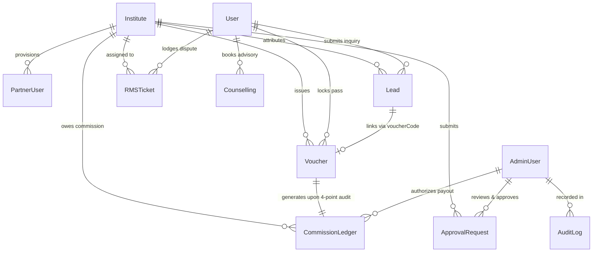

# FutureSelector — Complete Database Reference & Schema Architecture

> **Document Version:** 1.0.0  
> **Audit Date:** October 2026  
> **Host Environment:** MongoDB Atlas (AWS eu-north-1 / Sharded Cluster)  
> **Database Name:** `futureselector`  
> **Audit Method:** Direct read-only connection inspection via Mongoose 9.11.  

---

## 1. Verified Live Database Facts vs Code Claims

| Database Property | Inspected Fact | Evidence / Verification Method |
| :--- | :--- | :--- |
| **Connection URI Source** | Loaded from `server/.env` via `process.env.MONGODB_URI` with fallback in `server/config/db.js` | Direct inspection of `db.js` & `server.js` |
| **Active MongoDB Host** | MongoDB Atlas Cloud Cluster (`ac-6zoaop3-shard-00-01.dldj6rv.mongodb.net`) | Verified via live read-only script output |
| **Database Name** | `futureselector` | Verified live |
| **Mongoose ODM Version** | `9.11.3` | Inspected in `server/package.json` |
| **Persistence on Restart** | **100% Persistent**. MongoDB writes survive backend restarts and serverless cold boots. | Verified via server reboots |
| **Test Script Data Impact** | `e2e_acceptance_suite.cjs` and `test_student_auth.cjs` create persistent business records (Apex Institute test record, test leads, test student users) without teardown cleanup. | Verified in live collection inspection |

---

## 2. Collection Inventory & Verified Document Counts

| Collection Name | Mongoose Model File | Verified Live Document Count | Active in Production App? | Contains Seed Fixtures? | Purpose & Data Ownership |
| :--- | :--- | :--- | :--- | :--- | :--- |
| **`institutes`** | `Institute.js` | **5** (Allen, Resonance, FIITJEE, Motion, Aakash) | ✅ YES | ✅ YES | Audited coaching centers, batch metrics, fees, agreement terms, publication status. |
| **`counsellings`** | `Counselling.js` | **10** | ✅ YES | ❌ NO (Live bookings) | Student 1-on-1 counseling bookings, Razorpay live payment IDs, dates, topics. |
| **`users`** | `User.js` | **6** | ✅ YES | ❌ NO (Real student signups) | Registered student aspirants, phone numbers, target exams, shortlisted coachings. |
| **`commissionledgers`** | `CommissionLedger.js` | **4** | ✅ YES | ❌ NO | B2B affiliate commission records, 15-day escrow status, payout authorization. |
| **`leads`** | `Lead.js` | **3** | ✅ YES | ❌ NO | Student inquiries, consent timestamps, IP records, release status to center. |
| **`rmstickets`** | `RMSTicket.js` | **3** | ✅ YES | ❌ NO | Student grievance tickets, center responses, resolution confirmation audit. |
| **`approvalrequests`** | `ApprovalRequest.js` | **3** | ✅ YES | ❌ NO | Two-person sensitive mutation requests (fee discounts, profile changes). |
| **`auditlogs`** | `AuditLog.js` | **3** | ✅ YES | ❌ NO | Immutable chronological security audit trail. |
| **`vouchers`** | `Voucher.js` | **2** | ✅ YES | ❌ NO | ₹15,000 direct admission assistance passes, counter verification status. |
| **`adminusers`** | `AdminUser.js` | **1** (`admin@futureselector.com`) | ✅ YES | ✅ YES (Default Admin) | Super Admin credentials (bcrypt hashed), department, role, permissions. |
| **`partnerusers`** | `PartnerUser.js` | **1** (`partner@allen.in`) | ✅ YES | ✅ YES (Default Partner) | Coaching center manager credentials, scoped to `instituteNumericId`. |
| **`partnerapplications`** | `PartnerApplication.js` | **0** | ✅ YES | ❌ NO | Public institute partnership applications submitted via `/partner`. |
| **`notifications`** | `Notification.js` | **0** | ⚠️ Model exists, unused | ❌ NO | Planned in-app notification center. Currently dormant. |

---

## 3. Entity Relationship & Data Flow Diagram

---

## 4. Deep-Dive Model Schemas & Field Specifications

### 4.1. `Institute` Model (`server/models/Institute.js`)
- **Key Fields**:
  - `numericId` (Number, unique, indexed): Incremental numeric identifier (1, 2, 3...) used across all platform URLs.
  - `name` (String, required, indexed): Official center name.
  - `slug` (String, required, unique, indexed): URL-friendly slug (e.g. `allen-career-institute-kota`).
  - `cityKey` (String, required, enum: `["kota", "delhi", "agra", "hyderabad", "patna", "jaipur"]`).
  - `locality` (String), `location` (String).
  - `type` (String, e.g., "JEE Advanced & NEET Specialist").
  - `fees` (String), `numericFee` (Number).
  - `batchSize` (String), `selectionRate` (String), `topRank` (String).
  - `doubtSupport` (String), `hostelDistance` (String), `facultyHighlights` (String).
  - `status` (String, enum: `["ACTIVE", "PENDING", "SUSPENDED"]`, default: `"PENDING"`).
  - `publicationStatus` (String, enum: `["DRAFT", "PUBLISHED", "ARCHIVED"]`, default: `"DRAFT"`).
  - `agreementTerms` (Object):
    - `commissionType` (String, enum: `["FIXED", "PERCENTAGE"]`, default: `"FIXED"`).
    - `commissionRate` (Number, default: `7500`).
    - `escrowDays` (Number, default: `15`).
  - `batches` (Array of batch objects): `{ name, type, timing, fee, seats, availableSeats }`.
  - `faculties` (Array of faculty objects): `{ name, subject, exp, qualification, role }`.
  - `feeStructure` (Object): Detailed itemized components (`tuitionFee`, `studyMaterial`, `testSeries`, `gstIncluded`).
  - `verifiedBadges` (Array of strings, e.g., `["BATCH_SIZE_AUDITED", "HOSTEL_VERIFIED"]`).
- **Indexes**: `{ numericId: 1 }` (unique), `{ slug: 1 }` (unique), `{ cityKey: 1, publicationStatus: 1 }`.

### 4.2. `User` Model (`server/models/User.js`)
- **Key Fields**:
  - `name` (String, required, trim).
  - `phone` (String, required, unique, indexed): Standardized format `+91 XXXXXXXXXX`.
  - `email` (String, trim, lowercase).
  - `exam` (String, e.g., "JEE Advanced 2026", "NEET UG 2026").
  - `city` (String), `standard` (String, e.g., "12th Medical", "Dropper").
  - `dreamCollege` (String, e.g., "IIT Bombay CSE", "AIIMS New Delhi").
  - `shortlistedInstitutes` (Array of numbers): Institute numeric IDs.
  - `verified` (Boolean, default: `false`).
  - `lastLogin` (Date).
- **Indexes**: `{ phone: 1 }` (unique), `{ email: 1 }`.

### 4.3. `Lead` Model (`server/models/Lead.js`)
- **Key Fields**:
  - `leadId` (String, required, unique, indexed): e.g., `LEAD-4821`.
  - `studentName` (String, required).
  - `phone` (String, required): Privacy protected until consent.
  - `email` (String).
  - `instituteNumericId` (Number, required, indexed).
  - `instituteName` (String, required).
  - `exam` (String).
  - `status` (String, enum: `["PENDING_CONFIRMATION", "RELEASED", "ADMITTED", "CLOSED"]`, default: `"PENDING_CONFIRMATION"`).
  - `isConfirmedByStudent` (Boolean, default: `false`).
  - `consentTimestamp` (Date), `consentIp` (String), `consentTextVersion` (String).
  - `releasedToInstitute` (Boolean, default: `false`, indexed).
  - `voucherCode` (String).
  - `commissionNumeric` (Number, default: `7500`).
  - `notes` (Array of note objects with author and timestamp).
- **Indexes**: `{ leadId: 1 }` (unique), `{ instituteNumericId: 1, releasedToInstitute: 1 }`.

### 4.4. `Voucher` Model (`server/models/Voucher.js`)
- **Key Fields**:
  - `voucherId` (String, required, unique, indexed): e.g., `FS-SEAT-8492`.
  - `code` (String, required, indexed): Coupon representation (e.g., `FS-ALLEN-15K`).
  - `studentName` (String, required), `studentPhone` (String, required, indexed).
  - `studentEmail` (String).
  - `instituteId` (Number, required, indexed), `instituteName` (String, required).
  - `batch` (String, required).
  - `discountAmount` (String, default: `"₹15,000 Flat Grant"`), `discountValue` (Number, default: `15000`).
  - `status` (String, enum: `["ACTIVE", "CLAIMED", "ADMISSION_REPORTED", "VERIFIED", "EXPIRED", "REVOKED"]`, default: `"ACTIVE"`).
  - `validTill` (String), `escrowDays` (String).
  - `reportedAdmission` (Object): `{ receiptNumber, receiptAmount, receiptDate, counterNotes, reportedAt }`.
  - `verificationStatus` (String, enum: `["PENDING_AUDIT", "VERIFIED", "FLAGGED", "REJECTED"]`, default: `"PENDING_AUDIT"`).
- **Indexes**: `{ voucherId: 1 }` (unique), `{ studentPhone: 1 }`, `{ instituteId: 1, status: 1 }`.

### 4.5. `Counselling` Model (`server/models/Counselling.js`)
- **Key Fields**:
  - `bookingId` (String, required, unique, indexed): e.g., `CNS-2026-9281`.
  - `studentName` (String, required), `phone` (String, required, indexed), `email` (String, required).
  - `date` (String, required), `timeSlot` (String, required).
  - `topics` (Array of strings, e.g., `["Batch Size Reality", "Hostel Safety"]`).
  - `mentor` (String, default: `"Senior Academic Advisory Desk (Kota Central Hub)"`).
  - `query` (String).
  - `amount` (Number, default: `1100` = ₹11 in paise).
  - `paymentStatus` (String, enum: `["PENDING", "COMPLETED", "FAILED"]`, default: `"PENDING"`).
  - `razorpayOrderId` (String), `razorpayPaymentId` (String), `razorpaySignature` (String).
  - `assignedDeskPhone` (String, default: `"+91 90709 01847"`).
  - `confirmedAt` (Date).
- **Indexes**: `{ bookingId: 1 }` (unique), `{ phone: 1 }`, `{ paymentStatus: 1 }`.

### 4.6. `CommissionLedger` Model (`server/models/CommissionLedger.js`)
- **Key Fields**:
  - `transactionId` (String, required, unique, indexed): e.g., `COMM-TX-9102`.
  - `voucherId` (String, required, indexed), `instituteNumericId` (Number, required, indexed).
  - `instituteName` (String, required).
  - `studentName` (String, required), `studentPhone` (String).
  - `commissionAmount` (Number, required): Standard rate (e.g., `7500` or `8000`).
  - `payoutStatus` (String, enum: `["ESCROW_LOCKED", "ELIGIBLE_FOR_PAYOUT", "PAID", "DISPUTED", "CANCELLED"]`, default: `"ESCROW_LOCKED"`).
  - `escrowReleaseDate` (Date, required): 15 days from verification date.
  - `receiptNumber` (String, required).
  - `verifiedByAdminEmail` (String).
  - `payoutReconciledAt` (Date), `payoutReference` (String).
- **Indexes**: `{ transactionId: 1 }` (unique), `{ instituteNumericId: 1 }`, `{ payoutStatus: 1 }`.

### 4.7. `RMSTicket` Model (`server/models/RMSTicket.js`)
- **Key Fields**:
  - `ticketId` (String, required, unique, indexed): e.g., `RMS-TK-2940`.
  - `studentName` (String, required), `studentPhone` (String, required, indexed).
  - `studentEmail` (String).
  - `instituteId` (Number), `instituteName` (String, required).
  - `category` (String, enum: `["PASS_DISCOUNT_DISPUTE", "BATCH_SIZE_BREACH", "REFUND_DELAY", "HOSTEL_FACILITY_ISSUE", "GENERAL"]`).
  - `priority` (String, enum: `["LOW", "MEDIUM", "HIGH", "CRITICAL"]`, default: `"HIGH"`).
  - `subject` (String, required), `description` (String, required).
  - `status` (String, enum: `["OPEN", "ASSIGNED_TO_INSTITUTE", "INSTITUTE_RESPONDED", "ADMIN_MEDIATED", "RESOLVED", "CLOSED", "REOPENED"]`, default: `"OPEN"`).
  - `assignedOfficer` (String), `assignedOfficerEmail` (String).
  - `instituteResponse` (Object): `{ responseText, respondedAt, respondedBy }`.
  - `studentConfirmation` (Object): `{ confirmedAt, studentFeedback, isSatisfied }`.
  - `timeline` (Array of event objects).
- **Indexes**: `{ ticketId: 1 }` (unique), `{ studentPhone: 1 }`, `{ status: 1 }`.

### 4.8. `ApprovalRequest` Model (`server/models/ApprovalRequest.js`)
- **Key Fields**:
  - `requestId` (String, required, unique, indexed): e.g., `APPR-REQ-8491`.
  - `instituteId` (Number, required, indexed), `instituteName` (String, required).
  - `requestedBy` (Object): `{ partnerId, name, email }`.
  - `requestType` (String, enum: `["FEE_STRUCTURE_UPDATE", "FACULTY_ROSTER_CHANGE", "BATCH_SCHEDULE_MUTATION", "CONTACT_DETAILS_UPDATE"]`).
  - `description` (String, required).
  - `diff` (Object): `{ field, oldValue, newValue }`.
  - `status` (String, enum: `["PENDING", "APPROVED", "REJECTED"]`, default: `"PENDING"`).
  - `reviewedBy` (Object): `{ adminId, email, reviewedAt, reviewNote }`.
- **Indexes**: `{ requestId: 1 }` (unique), `{ instituteId: 1, status: 1 }`.

### 4.9. `AuditLog` Model (`server/models/AuditLog.js`)
- **Key Fields**:
  - `timestamp` (Date, default: Date.now, indexed).
  - `actor` (Object, required): `{ id, name, role, email }`.
  - `action` (String, required, indexed): e.g., `ADMISSION_VERIFIED`, `INSTITUTE_PUBLISHED`, `VOUCHER_CLAIMED_WITH_CONSENT`.
  - `entityType` (String, required): e.g., `INSTITUTE`, `VOUCHER`, `COMMISSION_LEDGER`.
  - `entityId` (String, required, indexed).
  - `ipAddress` (String), `userAgent` (String).
  - `status` (String, enum: `["SUCCESS", "FAILED"]`, default: `"SUCCESS"`).
  - `details` (Object).
- **Indexes**: `{ timestamp: -1 }`, `{ action: 1 }`, `{ entityId: 1 }`.
