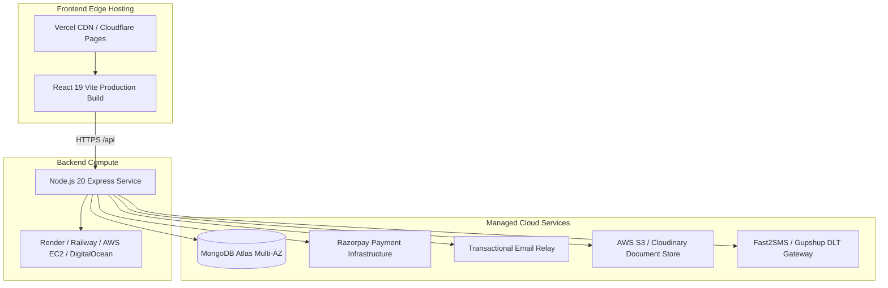

# FutureSelector — Deployment Readiness, Infrastructure & Launch Blockers

> **Document Version:** 1.0.0  
> **Audit Date:** October 2026  
> **Scope:** Evaluation across 3 launch horizons: (1) College / Placement Demo, (2) Private Beta, (3) Public Production.  

---

## 1. Launch Horizon Evaluation Matrix

| Readiness Criteria | College / Placement Demo | Private Beta (Pilot Centers) | Public Production Launch | Current Status & Audit Finding |
| :--- | :--- | :--- | :--- | :--- |
| **Frontend UI & Visual Aesthetics** | ✅ READY | ✅ READY | ✅ READY | Rich UI with Framer Motion, 3D Canvas, TailwindCSS, SpotlightCards, and Responsive Layouts. |
| **Live Database Persistence** | ✅ READY | ✅ READY | ✅ READY | MongoDB Atlas cluster connected and persistent across reboots. |
| **Razorpay Payment Gateway** | ✅ READY | ✅ READY | ✅ READY | Live API keys configured (`rzp_live_...`). Real payments verified. |
| **Core Business Workflows (A-S)** | ✅ READY | ⚠️ MINOR GAPS | ❌ BLOCKERS | Comparison engine (`Compare.jsx`) needs live API link; 4 admin mock pages need real APIs. |
| **SMS OTP Verification** | ⚠️ OK for Demo (2026) | ❌ BLOCKER | ❌ BLOCKER | Indian DLT registration & real SMS gateway API (Fast2SMS / Gupshup) required. |
| **Transactional Email Delivery** | ⚠️ OK for Demo | ⚠️ NEEDS DOMAIN SMTP | ❌ BLOCKER | Custom business domain SMTP (e.g. `support@futureselector.com`) needed for deliverability. |
| **Cloud File Storage (Receipts/Logos)** | ⚠️ OK for Demo | ❌ BLOCKER | ❌ BLOCKER | Receipts currently stored as string metadata. AWS S3 or Cloudinary required for image uploads. |
| **Rate Limiting & Anti-DDoS** | ⚠️ Not needed for demo | ❌ BLOCKER | ❌ BLOCKER | `express-rate-limit` must be mounted on public endpoints. |
| **Strict Production CORS** | ⚠️ Not needed for demo | ❌ BLOCKER | ❌ BLOCKER | Change `origin: "*"` to whitelisted production domains. |
| **Error Monitoring & APM** | ⚠️ Not needed for demo | ⚠️ RECOMMENDED | ❌ BLOCKER | Sentry or LogRocket needed for production crash analytics. |

---

## 2. Infrastructure Architecture & Hosting Topology

---

## 3. Environment Configuration Checklist

To move the system to production, configure these variables in the production hosting dashboard without exposing secrets in source code:

| Environment Variable | Required in Demo? | Required in Production? | Purpose & Safe Specification |
| :--- | :--- | :--- | :--- |
| `PORT` | Optional (default: 3000) | Required | Network listener port (e.g., 3000 or 8080). |
| `NODE_ENV` | Optional | **CRITICAL** | Set to `"production"`. Disables stack traces in HTTP 500 errors and turns off demo OTP bypass. |
| `MONGODB_URI` | Configured | **CRITICAL** | Production connection string with dedicated database user privileges (readWrite). |
| `JWT_SECRET` | Configured | **CRITICAL** | Cryptographically random 64-character secret for student, partner, and admin JWT signatures. |
| `ADMIN_SECRET_KEY` | Configured | **DEPRECATE** | Deprecate in production; require email/password + MFA for Super Admin. |
| `RAZORPAY_KEY_ID` | Configured (`rzp_live_...`) | **CRITICAL** | Live Razorpay merchant key ID. |
| `RAZORPAY_KEY_SECRET` | Configured | **CRITICAL** | Live Razorpay merchant webhook and signature verification secret. |
| `EMAIL_USER` / `EMAIL_PASS` | Configured | **CRITICAL** | Transactional SMTP credentials. |
| `SMS_GATEWAY_API_KEY` | None (Mocked) | **CRITICAL** | DLT-registered API key for Indian mobile OTP delivery. |
| `AWS_S3_BUCKET` / `AWS_ACCESS_KEY` | None | **CRITICAL** | S3 bucket for verified admission receipt image uploads. |

---

## 4. Launch Readiness Summary

### Level 1: College / Placement / SDE Interview Demo — 🟢 100% READY
- The application is visually stunning, responsive, has 3D interactive graphics, and works smoothly.
- Real Razorpay live payment gateway is integrated and verified.
- Super Admin operations suite features 13 working operational modules.
- Live database persistence with MongoDB Atlas is verified.
- **Verdict**: Fully ready for impressive placement presentations and senior SDE interview evaluations.

### Level 2: Private Beta (Pilot with 3–5 Kota Centers) — 🟡 70% READY
- Requires linking `Compare.jsx` to live `GET /api/institutes`.
- Requires hooking up real transactional email SMTP with custom domain.
- Requires AWS S3 bucket for student admission receipt photo uploads.

### Level 3: Public Commercial Launch — 🔴 45% READY
- Blocked by Indian Telecom DLT registration for SMS OTPs.
- Blocked by lack of rate limiting, strict CORS, and real CMS/Course backend models.
