# FutureSelector — Comprehensive Project Overview

> **Document Version:** 1.0.0  
> **Audit Date:** October 2026  
> **Status:** Verified from Codebase & MongoDB Atlas Inspection  
> **Author:** Antigravity Engineering & QA Team  

---

## 1. Executive Summary & Problem Statement

### The Problem in Indian Coaching Hubs
Every year, over 2.5 million students in India prepare for national competitive exams such as **JEE (Main & Advanced)** and **NEET (UG)**. A significant proportion of these aspirants relocate to major coaching ecosystems such as **Kota (Rajasthan)**, **Kalu Sarai (Delhi NCR)**, **Hyderabad**, and **Agra**.

Despite heavy marketing and claims by coaching franchises, students and parents face severe systemic challenges:
1. **Misleading Batch Sizes**: Marketing brochures claim individual attention with batch sizes of 40–45 students, whereas ground reality often reveals crowded lecture halls with 80–120 students.
2. **Opaque Fee Structures**: Surprises at the fee counter including hidden GST, undisclosed study material costs, separate test series fees, and arbitrary registration charges.
3. **Ghost / Celebrity Faculty Marketing**: Star faculties are promoted on billboards to attract enrollments, but classes are frequently taken by junior or trainee faculties.
4. **Hostel & Living Condition Risks**: Substandard accommodations, long commute distances from study centers, and lack of mental health or grievance resolution support.
5. **No Independent Escrow or Mediation**: Once fees are deposited, students have zero leverage to resolve disputes regarding batch transfers, refund claims, or promised facilities.

---

## 2. What FutureSelector Is & The Solution

**FutureSelector** is an audited discovery, comparison, fee-protection, and grievance redressal platform designed specifically for competitive exam coaching institutes across India.

### Core Value Propositions:
- **Independent Coaching Discovery**: Real institute profiles audited for classroom batch sizes, verified faculty rosters, itemized fee breakdowns, and nearest hostel distances.
- **₹15,000 Direct Admission Assistance Pass (Voucher)**: Transparent fee waiver passes that students lock on the platform and present at the coaching accounts counter during offline admission.
- **15-Day Escrow & Grievance Protection (RMS)**: A 3-way dispute resolution mechanism connecting Students, Institute Center Managers, and FutureSelector Super Admins to resolve counter disputes.
- **1-on-1 Academic Counseling Booking**: Live appointment scheduling with Kota academic counseling desks, backed by Razorpay live payment gateway integration.
- **Multi-Tenant Partner & Super Admin Operations Suite**: Dedicated enterprise portals for coaching center directors and FutureSelector platform operations.

---

## 3. Target User Personas

| Persona | Role in Platform | Primary Needs & Actions |
| :--- | :--- | :--- |
| **Student / Parent Aspirant** | End Consumer | Search coachings by city/exam/batch, compare side-by-side, download comparison reports, lock ₹15,000 admission passes, book counseling, log counter grievances. |
| **Coaching Center Partner** | Enterprise Tenant | Claim/manage institute profile, view attributed student leads (with explicit student consent), report offline admissions with receipts, respond to RMS grievance tickets. |
| **FutureSelector Super Admin** | Platform Operator | Manually onboard institutes, provision partner credentials, audit & approve sensitive profile mutations, verify reported admissions with 4-point audit, manage commission ledgers, resolve grievances. |

---

## 4. System Boundaries & Core Entities

```mermaid
graph TB
    subgraph Public_Domain [Public & Student Portal]
        Student[Student / Parent]
        Catalog[Institute Search & Compare]
        Pass[₹15,000 Admission Pass]
        Counseling[Advisory Booking / Razorpay]
        RMS_Student[Grievance Lodging]
    end

    subgraph Partner_Domain [Institute Partner Portal]
        Partner[Center Accounts & Ops]
        Leads[Attributed Leads with Consent]
        AdmReport[Offline Admission Reporting]
        RMS_Partner[Grievance Response]
    end

    subgraph Admin_Domain [Super Admin Suite - 13 Modules]
        SuperAdmin[Operations Leadership]
        InstMgmt[Institute Onboarding & Publishing]
        ApprovalFlow[Sensitive Mutation Approval]
        AdmVerify[4-Point Admission Verification]
        FinanceLedger[Escrow & Commission Ledger]
        AuditTrail[Immutable Audit Logs]
    end

    subgraph Persistence [Data Layer]
        Atlas[(MongoDB Atlas Production)]
    end

    Student --> Catalog
    Student --> Pass
    Student --> Counseling
    Student --> RMS_Student

    Pass --> Atlas
    Counseling --> Atlas
    RMS_Student --> Atlas

    Partner --> Leads
    Partner --> AdmReport
    Partner --> RMS_Partner

    Leads --> Atlas
    AdmReport --> Atlas
    RMS_Partner --> Atlas

    SuperAdmin --> InstMgmt
    SuperAdmin --> ApprovalFlow
    SuperAdmin --> AdmVerify
    SuperAdmin --> FinanceLedger
    SuperAdmin --> AuditTrail

    InstMgmt --> Atlas
    ApprovalFlow --> Atlas
    AdmVerify --> Atlas
    FinanceLedger --> Atlas
    AuditTrail --> Atlas
```

---

## 5. Business & Monetization Model

1. **Student Side**:
   - Platform discovery, search, comparison, and admission passes are **100% Free** for students.
   - Comprehensive Kota Academic Advisory Sessions are priced at a nominal verification charge (₹11) processed via Razorpay Live Gateway.
2. **Institute Partner Side (B2B)**:
   - Institutes enter into institutional affiliate/partner agreements with FutureSelector.
   - For every verified offline admission attributed via FutureSelector's registered admission pass, the institute pays an agreed referral commission (standard benchmark: ₹7,500 – ₹10,000 per verified student).
   - Commissions are locked in an **Escrow Ledger** for 15 days to protect student enrollment validity and handle refund contingencies before payout authorization.
