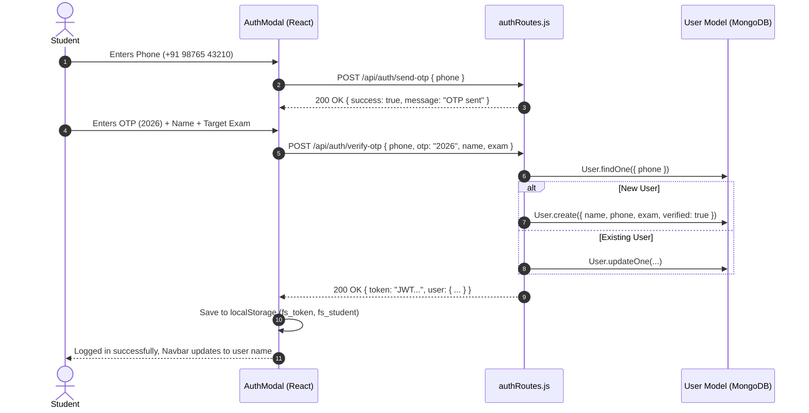
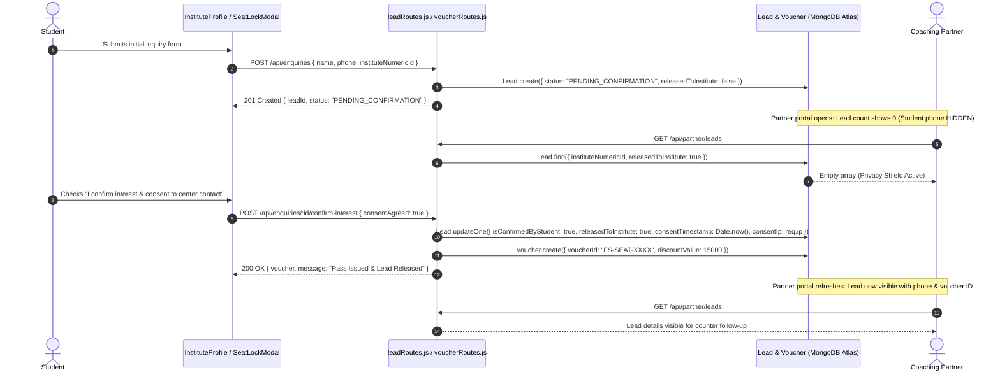
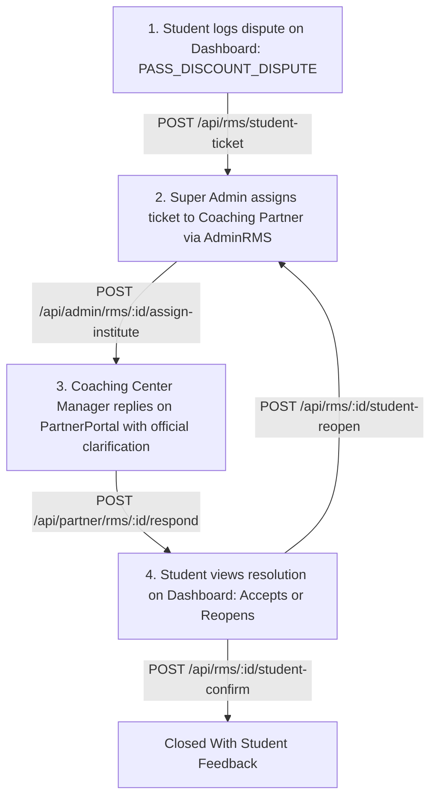
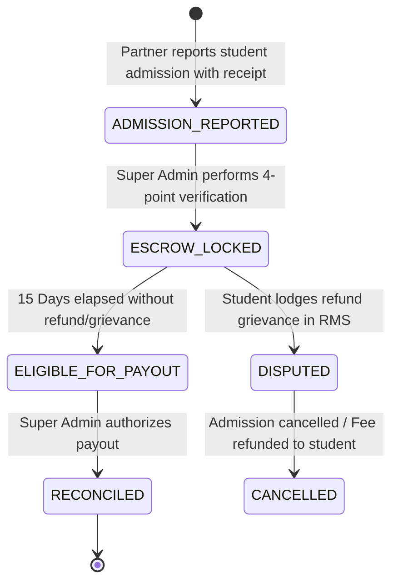

# FutureSelector — Complete Business & Technical Workflows (Hinglish Guide)

> **Document Version:** 1.0.0  
> **Audit Date:** October 2026  
> **Language:** Professional Technical Hinglish (Tailored for CSE Students & SDE Interviews)  
> **Rule:** Real verified workflows mapped to actual controllers, models, and MongoDB state transitions.  

---

## Workflow Overview: Teeno Roles Ka Interconnection

FutureSelector ek multi-stakeholder ecosystem hai jisme teen mukhya actors hote hain:
1. **Student / Aspirant**: Kota/Delhi/Agra/Hyderabad me coaching dhoondhta hai, transparent data compare karta hai, ₹15,000 ka admission voucher lock karta hai, ya ₹11 me Kota counseling book karta hai.
2. **Coaching Partner (Center Manager/Director)**: Super Admin dwara onboard hota hai, sirf unhin leads ka phone number dekh pata hai jinhone **explicit consent** diya ho, offline admission receipt report karta hai, aur grievance solve karta hai.
3. **Super Admin (Operations Lead)**: Institute create karta hai, draft se publish karta hai, partner ko invite karta hai, sensitive changes (fee hike) ko approve karta hai, offline admission receipts ka 4-point audit karta hai, aur 15-day escrow commission release karta hai.

---

## WORKFLOW A — Student Registration Aur Login

### 1. Business Purpose
Student ko platform par quickly onboard karna bina complex password yaad rakhe, taaki wo apne shortlisted coachings, vouchers aur counseling sessions ko MongoDB me permanently store kar sake.

### 2. User Journey (Step-by-Step)
1. Student website par aata hai aur "Login" ya navbar par "Student Sign In" click karta hai.
2. `AuthModal.jsx` ya `Login.jsx` khulta hai.
3. Student apna 10-digit mobile number enter karta hai.
4. "Get OTP" click karne par client `POST /api/auth/send-otp` call karta hai.
5. Student OTP enter karta hai (current demo default: `2026`) aur apna naam/exam select karta hai.
6. "Verify & Continue" click karne par client `POST /api/auth/verify-otp` call karta hai.
7. Backend response me student JWT token aur user object bhejta hai. Client ise `localStorage.setItem("fs_token", token)` aur `fs_student` me save kar leta hai.

### 3. Technical Sequence & State Transitions

### 4. Verification Status
- **Status**: `WORKING_AND_VERIFIED` (Automated suite `test_student_auth.cjs` me verified).
- **Limitation**: SMS gateway simulated hai (fixed OTP `2026`). Real production ke liye SMS provider API plug karni hogi.

---

## WORKFLOW B — Student Profile Creation Aur Editing

### 1. Business Purpose
Student ki academic details (11th/12th/Dropper, Target Year, Dream College, Home City) capture karna taaki recommendation engine personalized coaching dikha sake.

### 2. User Journey
1. Student `Dashboard.jsx` par jata hai aur "Edit Profile" button click karta hai.
2. Modal me Dream College (e.g., "IIT Bombay CSE", "AIIMS New Delhi"), Current Class aur City update karta hai.
3. "Save Changes" click karta hai.
4. Client `PUT /api/auth/profile` ko updated JSON payload bhejta hai with `Authorization: Bearer <token>`.
5. Backend JWT verify karke student ka MongoDB document update karta hai aur updated user object return karta hai.

### 3. Verification Status
- **Status**: `WORKING_AND_VERIFIED` (`PUT /api/auth/profile` verified in `test_student_auth.cjs`).

---

## WORKFLOW C — Coaching Discovery, Search, Filtering & Comparison

### 1. Business Purpose
Student ko marketing hype se door karke actual ground reality metrics (Batch Size, Faculty Roster, Distance from Hostel, Selection Ratio) compare karne ki suvidha dena.

### 2. User Journey
1. Student `/find-coaching` par jata hai.
2. Filters select karta hai: City (Kota, Delhi, Hyderabad), Exam (JEE, NEET), Batch (11th, 12th, Dropper), Max Fee budget.
3. Client `GET /api/institutes?city=kota&exam=jee` request bhejta hai.
4. Filtered institutes render hote hain. Student kisi coaching ke "Compare" icon par click karta hai (max 3 institutes).
5. Student `/compare?ids=1,2` page par jata hai jahan side-by-side comparison table dikhta hai.
6. "Download Comparison PDF" click karne par browser me client-side `jspdf` se multi-page comparison report generate ho jati hai.

### 3. Critical Audit Note (Known Limitation)
- **Status**: Discovery is `WORKING_AND_VERIFIED`.
- **Comparison Engine Bug**: `Compare.jsx` currently reads from `client/src/data/institutes.js` instead of calling `instituteAPI.compare`. Isliye Super Admin dwara MongoDB me create kiya gaya naya institute comparison table me show nahi hota. (Task P0-01).

---

## WORKFLOW D & E — Enquiry Submission Aur Explicit Student Consent (Privacy Shield)

### 1. Business Purpose
Indian coaching market me sabse badi shikayat ye hoti hai ki inquiry form bharte hi 20 alag-alag call centers se spam calls aane lagte hain.
FutureSelector ka **Privacy Shield Architecture** guarantee karta hai ki student ka phone number coaching center ko **TAB TAK NAHI DIKHEGA** jab tak student explicitly "Confirm Interest & Share Contact" checkbox click na kare.

### 2. Sequence Diagram

### 3. Verification Status
- **Status**: `WORKING_AND_VERIFIED` (E2E Test Scenario B me 100% pass: Verified that Partner cannot see unconfirmed lead, but immediately sees it after explicit consent).

---

## WORKFLOW F & G — ₹15,000 Admission Seat-Lock Pass & Student Dashboard

### 1. Business Purpose
Student ko counter par bargaining na karni pade. FutureSelector ₹15,000 ka flat waiver voucher deta hai jo student coaching ke accounts desk par dikhata hai.

### 2. User Journey
1. Student coaching card ya comparison table par "Lock ₹15,000 Fee Pass" click karta hai.
2. `SeatLockModal.jsx` open hota hai. Student batch select karta hai (e.g. "Target 2026 Dropper").
3. "Confirm Seat Lock" submit hone par `POST /api/vouchers/claim` call hota hai.
4. Response me voucher code milta hai (e.g., `FS-SEAT-8492`).
5. Student `Dashboard.jsx` ke "Admission Passes" tab me jaakar:
   - Voucher code copy kar sakta hai.
   - WhatsApp par parents ke sath share kar sakta hai.
   - PDF Pass download kar sakta hai (jsPDF format with QR representation).

### 3. Verification Status
- **Status**: `WORKING_AND_VERIFIED`.

---

## WORKFLOW H — 3-Way Student Grievance Redressal (RMS)

### 1. Business Purpose
Agar student coaching admission counter par jata hai aur coaching receptionist bolti hai: *"FutureSelector ka pass valid nahi hai"* ya *"Registration fee alag se deni hogi"*, toh student coaching center me ladne ke bajaye FutureSelector RMS me ticket raise karta hai.

### 2. 3-Way Dispute Cycle

### 3. Verification Status
- **Status**: `WORKING_AND_VERIFIED` (E2E Test Scenario D me full 4-step loop pass).

---

## WORKFLOW I, J, K, L — Super Admin Institute Onboarding, Partner Provisioning & Publication

### 1. Business Purpose
Koi bhi fake coaching platform par register na ho sake. Super Admin khud physical audit ke baad institute create karta hai, draft mode me rakhta hai, partner ko credentials deta hai, aur verify karke publish karta hai.

### 2. User Journey & State Engine
1. **Admin Manual Creation**: Super Admin `/admin/institutes` par "Add Institute" form bharta hai.
   - API: `POST /api/admin/institutes/manual`
   - MongoDB: `Institute.create({ publicationStatus: "DRAFT", status: "PENDING" })`
   - **Data Isolation**: Public website `/api/institutes` par ye coaching **NAHI DIKHTI**.
2. **Partner Account Provisioning**: Super Admin "Provision Partner" button click karta hai with partner email & temporary password.
   - API: `POST /api/admin/institutes/:id/provision-partner`
   - MongoDB: `PartnerUser.create({ email, instituteId, role: "INSTITUTE_ADMIN" })`
3. **Publication**: Super Admin audit complete karke "Publish" click karta hai.
   - API: `POST /api/admin/institutes/:id/publish`
   - MongoDB: `Institute.updateOne({ publicationStatus: "PUBLISHED", status: "ACTIVE" })`
   - Coaching ab public search me visible ho jati hai.
4. **Suspension**: Agar coaching terms todti hai, Admin "Suspend" click karta hai.
   - API: `POST /api/admin/institutes/:id/suspend`
   - Immediate Effect: Partner token se aane wali sabhi future requests `partnerAuth.js` middleware me **HTTP 403 Forbidden** ban jaati hain.

### 3. Verification Status
- **Status**: `WORKING_AND_VERIFIED` (E2E Test Scenario A & F me fully verified).

---

## WORKFLOW M — Sensitive Profile Mutation & Two-Person Approval

### 1. Business Purpose
Agar partner coaching portal me tuition fees badhana chahta hai ya faculty change karna chahta hai, toh wo seedhe public page par reflect nahi ho sakti. Usse Super Admin ka approval lena mandatory hota hai.

### 2. Steps
1. Partner `/partner` portal ke Profile Studio me fee update submit karta hai.
2. Backend me seedhe `Institute` update nahi hota. Ek naya record banta hai: `ApprovalRequest.create({ requestType: "FEE_STRUCTURE_UPDATE", status: "PENDING" })`.
3. Super Admin `/admin/approvals` page par diff (Old Value vs New Value) inspect karta hai.
4. Admin "Approve" click karta hai (`POST /api/admin/approvals/:id/approve`).
5. Backend approval request ko `APPROVED` mark karta hai aur `Institute` document me change apply karta hai.

### 3. Verification Status
- **Status**: `WORKING_AND_VERIFIED` (E2E Test Scenario C me verified).

---

## WORKFLOW N, O, P — Offline Admission Reporting, 4-Point Audit & 15-Day Escrow Commission

### 1. Business Purpose
FutureSelector ka core B2B revenue engine: Coaching me jab student pass lekar admission leta hai, toh commission ledger me record banta hai aur 15 din ke escrow period ke baad payout authorize hota hai.

### 2. 4-Point Admission Verification Criteria
Super Admin kisi bhi admission ko approve karne se pehle 4 points verify karta hai:
1. **Voucher Attribution**: Kya student ka voucher ID live database me valid hai?
2. **Fee Receipt Authenticity**: Kya coaching partner dwara uploaded fee receipt number (`REC-XXXX`) valid amount show karta hai?
3. **Student Identity Match**: Kya receipt par student ka naam aur phone number registered lead se match karta hai?
4. **Duplicate Prevention**: Kya is voucher code par pehle se commission ledger create ho chuka hai? (Duplicate verification HTTP 400 se reject hoti hai).

### 3. Commission Lifecycle State Diagram

### 4. Verification Status
- **Status**: `WORKING_AND_VERIFIED` (E2E Test Scenario E me 100% verified with automatic ledger creation and duplicate rejection).

---

## WORKFLOW Q — Super Admin Immutable Audit Logging

### 1. Business Purpose
Platform par hone wale har sensitive action (Institute publish/suspend, partner provision, admission verify, ledger payout, student consent) ka tamper-proof record maintain karna compliance aur fraud investigation ke liye.

### 2. Technical Implementation
- Utility file: `server/utils/auditLogger.js`
- Schema: `server/models/AuditLog.js` (Fields: `timestamp`, `actor`, `action`, `entityType`, `entityId`, `ipAddress`, `status`, `diff`).
- Viewable at: `/admin/audit-logs` (Read-only, no delete or edit API exists).

### 3. Verification Status
- **Status**: `WORKING_AND_VERIFIED`.

---

## WORKFLOW R & S — Session Expiry, Logout & Role Switching

### 1. Technical Isolation
- Agar developer ya admin same browser me Student aur Partner dono test karta hai, toh `api.js` request interceptor endpoint prefix ke hisab se token bhejta hai:
  - `/api/partner/*` -> `fs_partner_token`
  - `/api/admin/*` -> `fs_admin_token`
  - `/api/auth/*` -> `fs_token`
- Logout function specific role ke localStorage keys ko delete karta hai bina doosre role ko disturb kiye.
